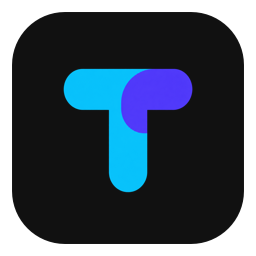
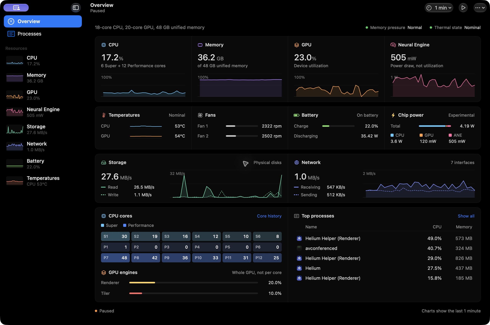

# Taskglass



A native macOS task manager for Apple silicon. Live CPU, GPU, memory, Neural Engine power, storage, network, battery, temperature and fan data, with a searchable process table.

## Install

**[Download the unsigned preview](https://github.com/KushagraBharti/taskglass/releases/tag/v0.1.0)** · macOS 14 Sonoma or newer · M-series Macs · free and open source under MIT.

Open the ARM64 DMG and drag Taskglass into Applications. The ZIP contains the same app.

This preview is **not Developer ID signed or notarized**. If macOS blocks opening, use **System Settings → Privacy & Security → Open Anyway** after checking the download came from this repository. Follow [Apple's instructions](https://support.apple.com/en-us/102445). The app needs no administrator helper or extra permissions to collect its supported readings.

Releases include SHA-256 checksums and GitHub build provenance. An ad-hoc signature verifies bundle integrity locally; it does not establish publisher identity or remove Gatekeeper approval.

```sh
shasum -a 256 -c SHA256SUMS.txt
# Optional verification with GitHub CLI:
gh attestation verify Taskglass-0.1.0-arm64-unsigned.dmg --repo KushagraBharti/taskglass
```



## Build from source

Requires Apple silicon, macOS 14+, and Swift 6.0+ with an Apple macOS SDK supporting macOS 14. Xcode or Command Line Tools work; full Xcode is not required. Release artifacts use SDK 26 or newer for current native macOS controls. The released app needs no developer tools.

```sh
git clone https://github.com/KushagraBharti/taskglass.git
cd taskglass
./scripts/build-app.sh
open dist/Taskglass.app
```

No third-party packages are installed. Build caches and generated output stay under `.build/` and `dist/`. To make the same unsigned archives locally:

```sh
./scripts/test.sh
./scripts/package-release.sh
./scripts/validate-release.sh
```

## Views

- Overview: resource graphs, temperature histories, fans, battery, component power, CPU core tiles, GPU engine activity and process leaders.
- Processes: native table, search, sorting, app/user filters, optional columns, an inspector, executable reveal, quit and force quit. Process identity is rechecked before termination.
- Resource pages include a native scrollable process outline with CPU, memory, combined disk I/O, read and write rankings, relative bars and double-click inspection. Every accessible process is included by default, with expandable app/helper groups and a flat-list option. CPU/RAM/Storage select their matching ranking automatically. GPU/ANE/network attribution is explicitly unavailable; their tables show the chosen measured resource instead.
- CPU: total/system history and per-core history grouped using device-tree identity. The M5 Pro reports Super and Performance groups rather than an assumed P/E layout.
- Memory: unified-memory history and allocation, app/wired/compressed/cached values, pressure and swap.
- GPU: driver-reported device, renderer and tiler utilization, shared memory and experimental power.
- Neural Engine: experimental power in watts or milliwatts, never an invented utilization percentage.
- Storage: physical disk rates, read/write IOPS, and APFS Data-volume capacity.
- Network: total traffic and per-interface rates for active physical interfaces.
- Battery: charge, charging state, signed power, cycles, full/design capacity ratio, temperature and voltage.
- Temperatures: CPU/GPU sensor-group averages, battery temperature, fan RPM, and individual named SMC/IOHID readings with a group filter.

The app uses a black appearance, distinct resource colors and native navigation. Charts, meters and core maps use vector shapes or small AppKit drawing views. No web view or charting runtime is included.

## Data sources and limits

| Measurement | Source | Definition or limitation |
| --- | --- | --- |
| System CPU | Mach host CPU ticks | Sample-to-sample deltas, normalized to 100% across logical cores. |
| Process CPU | libproc task time | Mach ticks converted with mach_timebase_info, then elapsed-time deltas. 100% means one core; a process may exceed 100%. |
| Core identity | IODeviceTree CPU entries | Logical CPU IDs and cluster types, with named sysctl tiers. Unknown groups retain neutral labels. |
| Process memory | libproc physical footprint and RSS | These have different definitions and shared allocations. Do not sum process columns to estimate system use. |
| System memory | Mach VM counters | Internal minus purgeable, plus wired and compressed memory. Cached files are external plus purgeable pages. |
| Memory pressure | Kernel pressure level | Not inferred from free-memory percentage. |
| GPU | AGX PerformanceStatistics | Device/renderer/tiler counters and unified-memory allocations. No per-core GPU usage is fabricated. |
| CPU/GPU/ANE power | Optional IOReport CLPC channels | Undocumented, experimental and version-specific. Currently enabled for recognized M5 Pro/Max CLPC drivers on macOS 27. Unsupported sources show unavailable. |
| Disk rates/IOPS | IOBlockStorageDriver counters | Aggregate physical block-driver activity. Cached file access can avoid disk. Driver changes reset the rate baseline. |
| Capacity | statfs on the Data volume | APFS volume/container accounting, not a partition-by-partition hardware inventory. |
| Network | 64-bit route interface counters | Active en interfaces, including local traffic. Virtual interfaces are omitted to reduce double counting. |
| Temperatures | Read-only SMC and IOHID | CPU/GPU SMC grouping is inferred from key prefixes, not a documented junction-temperature API. Original names and sources are retained. Invalid/out-of-range readings are excluded. |
| Fans | Read-only SMC | Actual RPM and reported maximum when readable. The app never changes fan speed. |
| Battery | IOKit battery/pack data | Capacity ratio is full/design capacity and may differ from Apple's health estimate. Driver time estimates vary with load. |
| Chip power total | CPU + GPU + ANE counters | Only the measured components. It is not total system or wall power. |

Neural Engine power is not utilization. A zero from a readable counter is preserved; an unavailable counter is not drawn as zero. Media-engine utilization and per-process GPU/ANE attribution are not implemented. Temperature grouping and private power APIs need validation on additional machines and OS versions.

Processes denied by macOS are omitted and described as accessible processes. New processes require a second read before rates can be calculated. Process leaders in Overview refresh every third sample using their own elapsed interval. CPU/GPU temperature groups, fans, battery and capacity refresh every 10 seconds; ordinary counters follow the 1/2/5-second setting. The full raw IOHID sensor list is read while Temperatures is selected, with an immediate full read on entry. IOHID remains a fallback for missing SMC groups on other panes.

View settings are saved in the normal macOS preferences domain `dev.taskglass.app`. Searches, process names and monitoring history are not saved. Selected-process trends retain up to 3 minutes while inspecting a process.

System history stays in memory, bounded to 1, 3 or 10 minutes and at most 601 samples. Charts share the selected time window and fill from the right after launch. Missing readings leave gaps. Sampling pauses while hidden, minimized or manually paused. A fully covered window keeps recording bounded history, while UI publication is deferred until it becomes visible again. Wake resets rate baselines. Nothing is sent to a server or saved as monitoring history.

## Verify and measure

```sh
./scripts/test.sh
./scripts/check-hardware.sh
./scripts/check-hardware.sh --gpu-workload
./scripts/measure-probe.sh
pgrep -fl '/Taskglass.app/Contents/MacOS/Taskglass'
python3 scripts/measure.py <PID> --seconds 60
```

The optional GPU check runs a bounded six-second Metal workload, then exits. It is a development fixture, not an app dependency. Test and profiling output stays under the project. See [measurements](measurements/README.md) for recorded resource costs and their limits.

## Project hygiene

All build output, compiler caches and research scratch files are under `.build/`. The app is in `dist/`. Both are ignored by Git. Local screenshots are ignored because they can contain process names. macOS itself may create its normal launch records, driver/compiler caches and diagnostic reports. No privileged helper, daemon, login item or system-wide package is installed.

```sh
rm -rf .build dist
```

To uninstall, quit Taskglass and move the app to Trash. Optionally reset its view preferences with `defaults delete dev.taskglass.app`. macOS manages its own app launch records and caches.

## Compatibility

Core CPU, memory, process, storage and network collection targets M-series Macs on macOS 14+. Physical validation so far is on an M5 Pro with macOS 27.0.1. CI runs core tests and builds on macOS 15 and 26 ARM64 runners. macOS 14 is the deployment target; its runtime and every chip configuration have not yet been physically tested.

GPU statistics, temperature names and fan readings depend on the driver and hardware. Fanless Macs have no fan readings. Component power is currently limited to recognized M5 Pro/Max CLPC drivers on macOS 27. Unsupported sources remain unavailable rather than displaying invented values.

See [development notes](DEVELOPMENT.md), [contributing](CONTRIBUTING.md), [security](SECURITY.md), [third-party notices](THIRD_PARTY_NOTICES.md) and the [logo provenance](Assets/Branding/README.md).
